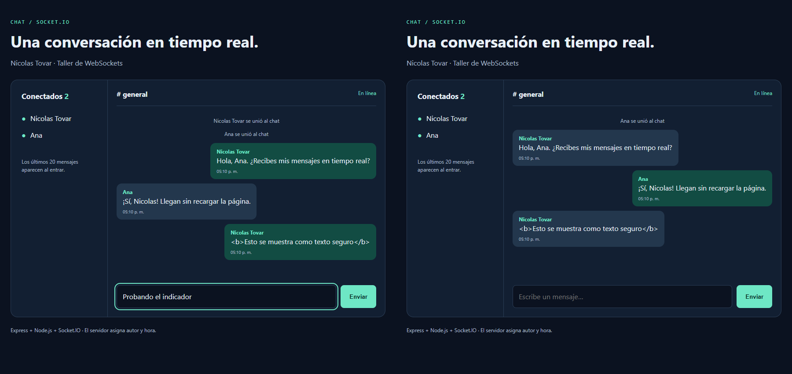

# Chat en tiempo real con Socket.IO

**Estudiante:** Nicolas Tovar  
**Integrante del grupo:** Miguel Angel Binilla  
**Código estudiantil:** pendiente de completar por el estudiante  
**Materia / grupo:** pendiente de completar por el estudiante  
**Fecha de preparación:** 29/10/2026  
**Fecha de entrega de la asignatura:** pendiente de confirmar  
**Repositorio:** https://github.com/HEFRA-ws/taller-chat-socketio

## 1. Cómo correr el proyecto

Requiere Node.js 18 o superior y npm. Verificado con Node.js v24.22.1.

```bash
git clone https://github.com/HEFRA-ws/taller-chat-socketio.git
cd taller-chat-socketio
npm install
npm start
```

Abre http://localhost:3000 en dos ventanas o pestañas e ingresa con nombres diferentes. `npm run dev` reinicia el servidor al guardar cambios. Si el puerto está ocupado, detén el otro servidor o configura la variable de entorno `PORT`.

## 2. Eventos implementados

| Evento | Lo emite | Lo escucha | Datos | Quién lo recibe |
|---|---|---|---|---|
| `entrar` | Cliente | Servidor | Nombre, string; callback de respuesta `{ ok, error? }` | Solo el servidor; el callback vuelve al solicitante |
| `sistema` | Servidor | Clientes | Aviso, string | Todos, mediante `io.emit` |
| `mensaje` | Cliente | Servidor | Solo el texto, string | Solo el servidor |
| `mensaje` | Servidor | Clientes | `{ autor, texto, hora }` | Todos, incluido el emisor |
| `usuarios` | Servidor | Clientes | Array de nombres | Todos |
| `escribiendo` | Cliente | Servidor | Sin datos: el nombre se consulta en el Map | Solo el servidor |
| `escribiendo` | Servidor | Clientes | Nombre, string | Todos menos quien escribe |
| `historial` | Servidor | Cliente | Array de hasta 20 mensajes | Solo quien acaba de entrar |
| `disconnect` | Socket.IO | Servidor y cliente de esa conexión | Evento de ciclo de vida | Manejadores locales de la conexión |

## 3. Retos obligatorios

- [x] Entrar con nombre y avisar al resto.
- [x] Enviar y recibir mensajes en tiempo real.
- [x] Actualizar la lista de conectados.
- [x] Mostrar quién está escribiendo durante 1,5 segundos, sin mostrar el aviso propio.
- [x] Borrar del Map por `socket.id` al desconectar y avisar a los demás.
- [x] Asignar el autor en el servidor.

Se verificaron los eventos con tres clientes automatizados y la interfaz con dos sesiones de navegador. También se probó que un objeto con un autor falso no se acepta como mensaje y que las etiquetas HTML se muestran como texto.

**Limitaciones:** usuarios e historial viven en memoria; se pierden al reiniciar el servidor. El nombre elegido no equivale a una identidad autenticada. El proyecto es una demostración académica y no incluye cuentas ni base de datos. Antes de entregar, el estudiante debe completar sus datos y revisar estas explicaciones.

## 4. Retos extra

| Reto | Implementación |
|---|---|
| Nombres únicos | Comparación de nombres sin distinguir mayúsculas antes de guardarlos; respuesta de error al solicitante mediante callback |
| Últimos 20 mensajes | Array en el servidor, recortado a 20; se envía mediante `socket.emit('historial', historial)` al entrar |

Además, el cliente vuelve a registrar su nombre al reconectarse y limita los avisos de escritura a uno cada 500 ms.

## 5. Captura

Dos clientes reales del chat, con nombres diferentes, lista de conectados y mensajes en ambas direcciones:



## 6. Lo que más me costó

Pendiente de redactar por el estudiante después de ejecutar y estudiar el proyecto. No se atribuye una experiencia personal que no haya confirmado.

## 7. Preguntas de sustentación

**1. ¿En qué se diferencian `socket.emit`, `socket.broadcast.emit` e `io.emit`?**

En el servidor, `socket.emit` envía a un cliente concreto; `socket.broadcast.emit` envía a todos menos a ese cliente; `io.emit` envía a todos, incluido ese cliente. En el navegador, `socket.emit` envía al servidor. Por eso los mensajes usan `io.emit` y el aviso de escritura usa broadcast.

**2. ¿Por qué el servidor no puede confiar en el nombre que manda el cliente?**

El cliente se puede modificar desde la consola. Si cada mensaje pudiera traer su propio autor, alguien podría enviar el nombre de otro. El servidor consulta el nombre registrado para ese `socket.id` y solo acepta texto en el evento `mensaje`. Esto evita cambiar el autor por mensaje, aunque no sustituye un sistema de autenticación.

**3. ¿Qué pasa con el Map si el servidor se reinicia? ¿Cómo lo arreglarías?**

El Map desaparece porque está en memoria. En este proyecto cada cliente vuelve a emitir `entrar` al reconectarse. Para conservar mensajes se necesitaría una base de datos. La presencia debe reconstruirse con las conexiones activas; guardar usuarios antiguos sin verificar su conexión dejaría usuarios fantasma.

**4. ¿Qué es el fallback a long-polling y cuándo entra en acción?**

Socket.IO puede transportar eventos mediante peticiones HTTP prolongadas cuando WebSocket no está disponible. Con la configuración predeterminada puede empezar con polling e intentar actualizar a WebSocket. Si la actualización falla, puede seguir usando polling sin cambiar los eventos de la aplicación.

**5. Si hubiera 10.000 usuarios, ¿por qué emitir en cada tecla sería un problema?**

Cada tecla podría generar miles de entregas y mucho trabajo de red, servidor y navegador. Broadcast evita el aviso al emisor, pero sigue llegando a todos los demás. Conviene limitar la frecuencia, enviar cambios de estado y usar salas. Aquí se limita el aviso a uno cada 500 ms; no se ha probado carga de 10.000 usuarios.

## 8. Checklist de entrega

- [x] Código funcional de los cinco retos y dos extras.
- [x] `node_modules/` excluido mediante `.gitignore`.
- [x] Captura con dos usuarios y lista de conectados.
- [x] Repositorio público con al menos seis commits descriptivos (verificado después de publicar).
- [x] Copia clonada en limpio: instalación, arranque y rutas HTTP verificados.
- [ ] Completar código estudiantil, materia/grupo y fecha de entrega.
- [ ] Redactar la experiencia personal de la sección 6.
- [ ] Revisar las respuestas y poder explicar cada parte en la sustentación.

## Fuentes y ayuda

- Taller base de Juan Bonilla: https://github.com/JuanBonilla1305/taller-chat-socketio
- Documentación de Socket.IO: https://socket.io/docs/v4/
- Se utilizó ayuda de IA (Codex) para implementar el código, preparar las explicaciones y ejecutar pruebas automatizadas. El estudiante debe revisar y comprender la entrega.
